

# Nadd · ند

### Your trip, blended into a scent from the farms of Saudi Arabia

**[▶ Try the live prototype](https://rawan0101.github.io/nadd/)**

Built to develop tourism in the Kingdom of Saudi Arabia · Submitted to the Tourism Development Fund Hackathon

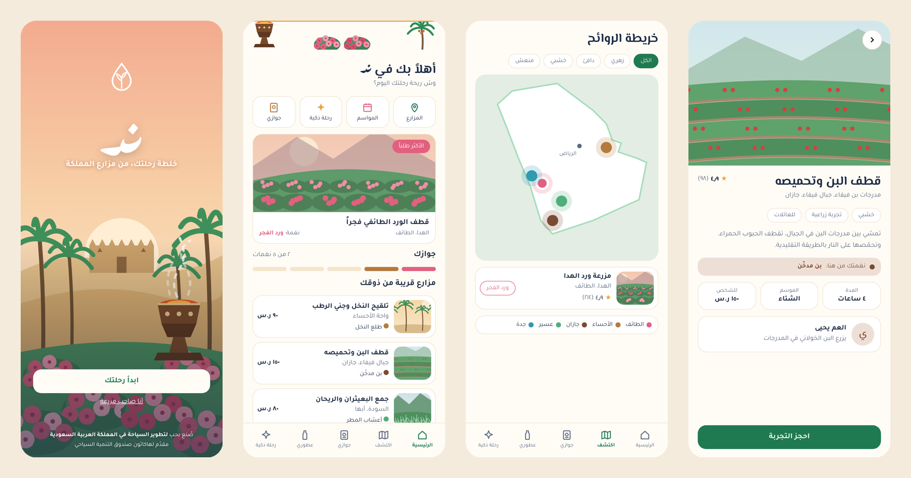
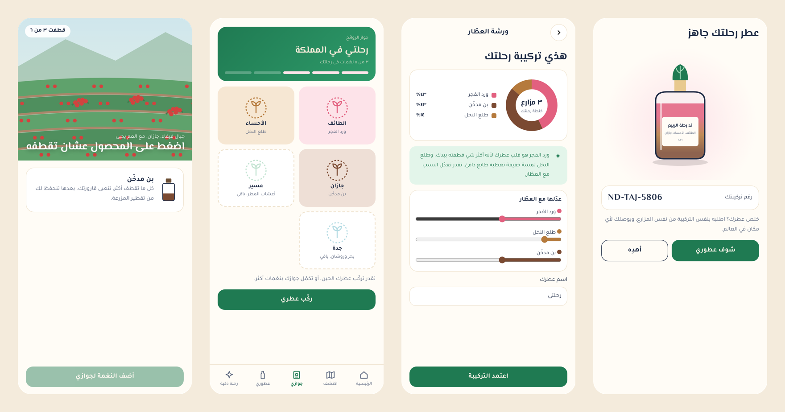

## The idea

Nadd turns a visit to a Saudi farm into a scent journey. Visitors pick with their own hands — Taif roses, Al-Ahsa palm pollen, Jazan coffee, Asir herbs — and every farm gives them a scent note, stamped into their **Scent Passport**. At the end of the trip, they blend the notes they collected into one perfume with a Saudi perfumer, guided by AI. No two perfumes are the same, because no two trips are the same.

The name comes from *nadd* (ند), a traditional Arabian blend of oud, musk and amber, just as every Nadd perfume is a blend of the places you visited.

## The problem

- **For tourists:** a farm visit ends with a few photos. There is nothing personal or lasting to take home.
- **For farmers:** tourism income depends on a short harvest season. Taif's rose season, for example, lasts only about 45 days.

## How it works

| Step | What happens |
|---|---|
| **1. Discover** | A scent map of Saudi farms, filtered by scent family, plus a calendar of harvest seasons |
| **2. Pick** | Book an experience and pick the crop yourself; each farm adds a note to your Scent Passport |
| **3. Blend** | Proportions are suggested from what you picked at each farm, then fine-tuned with the perfumer |
| **4. Reorder** | Your blend is saved under a unique code, so you can reorder it from the same farms anywhere in the world |

## Screens

| Welcome | Home | Scent map | Farm experience |
|:---:|:---:|:---:|:---:|
| 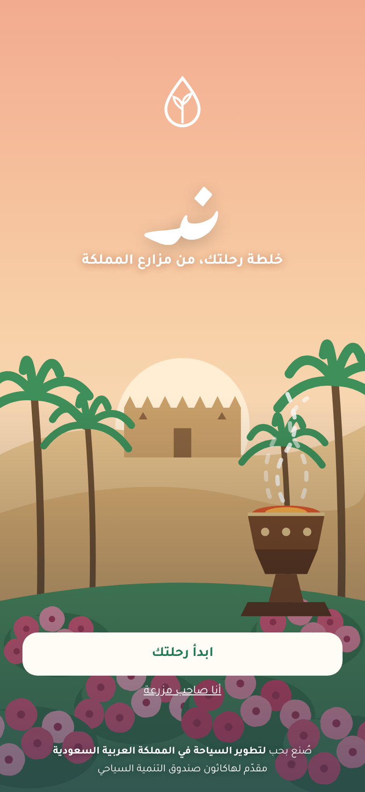 | 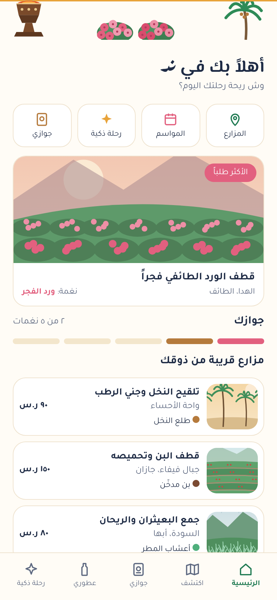 | 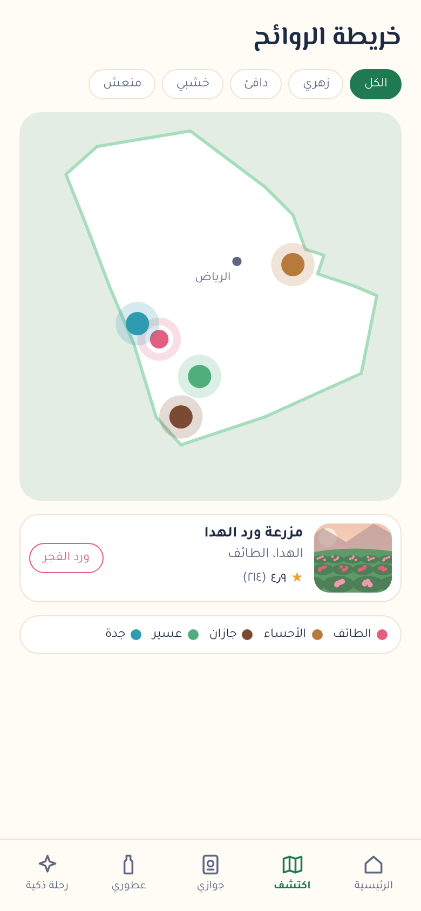 | 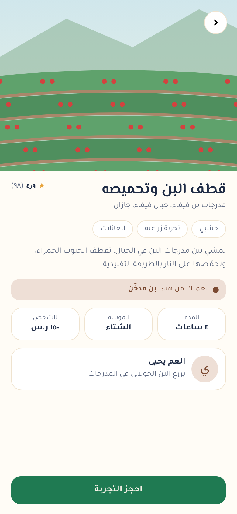 |
| **Picking** | **Scent passport** | **Perfume blend** | **Your perfume** |
| 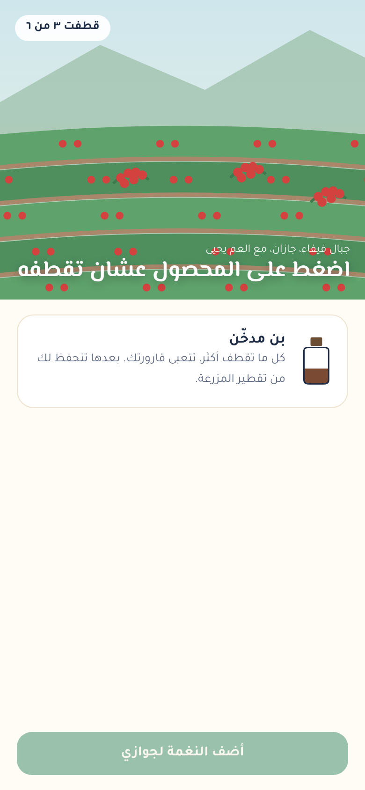 | 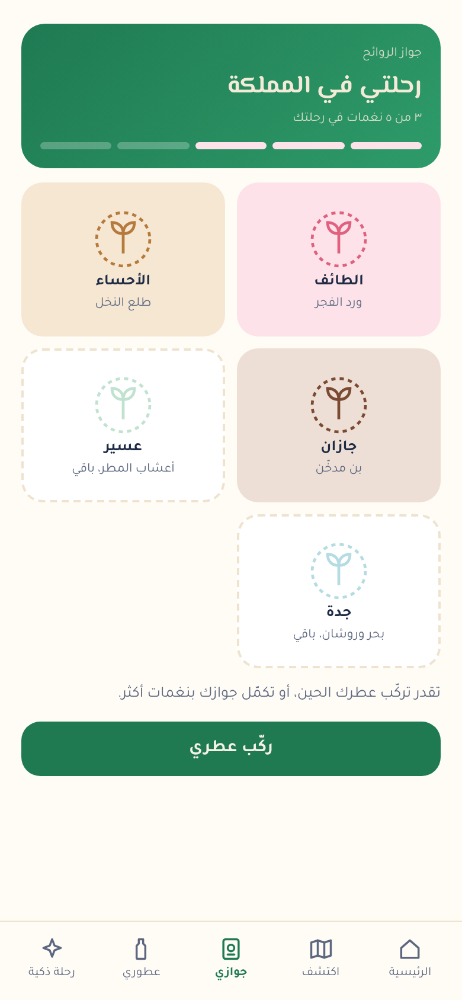 | 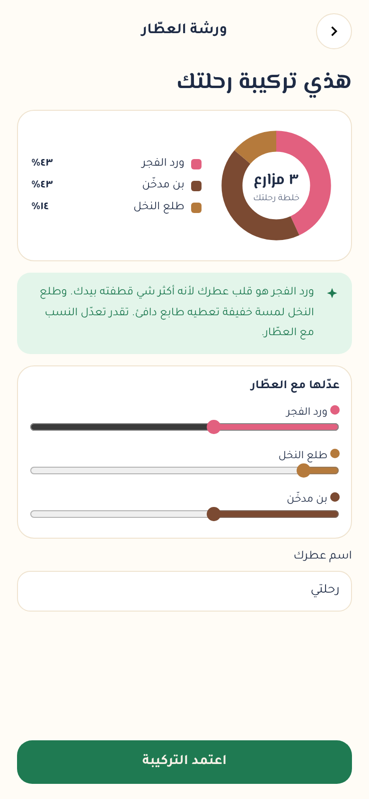 | 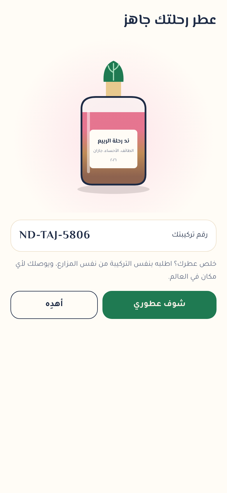 |
| **Harvest seasons** | **Booking** | **Smart route** | **Farmer dashboard** |
| 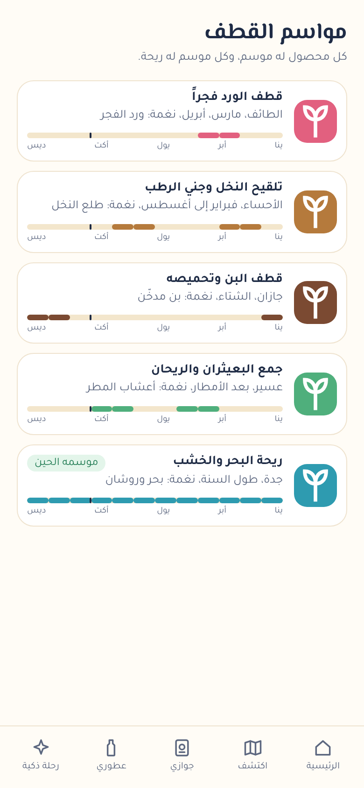 | 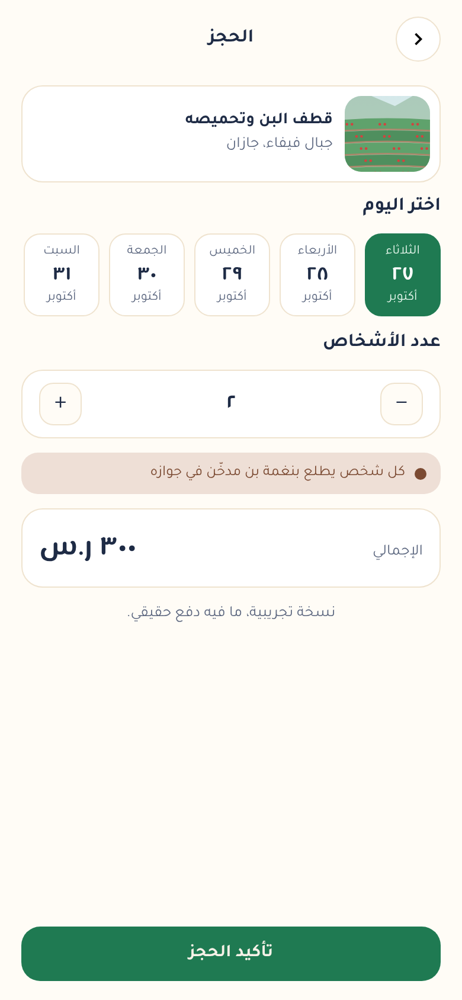 | 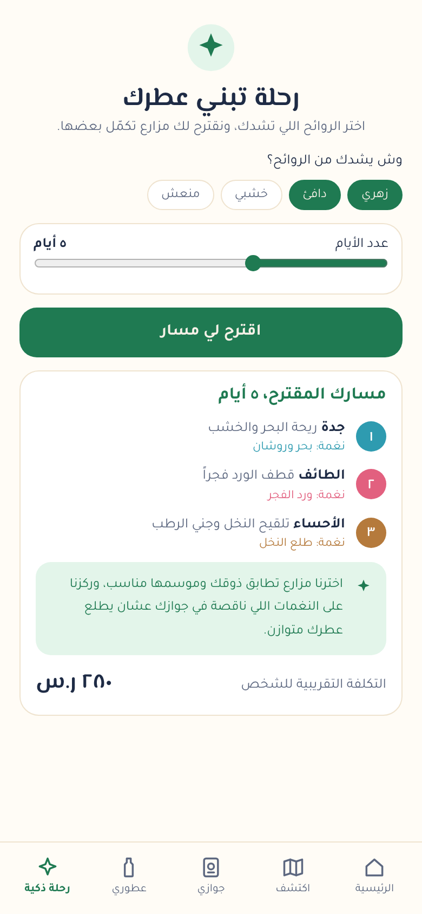 | 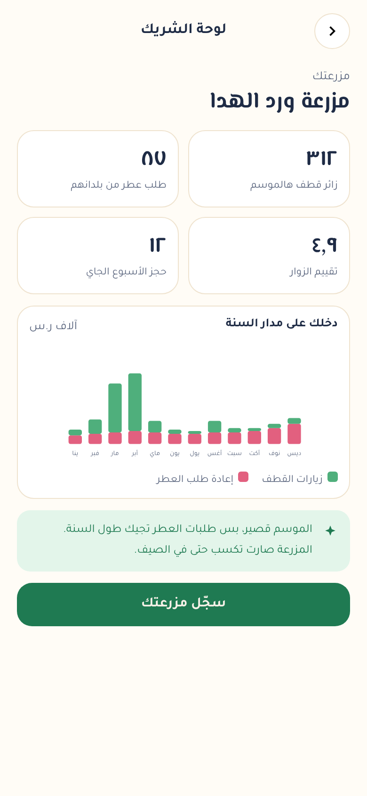 |

## Why it matters

- **Year-round income for farmers:** perfume reorders keep money flowing to the farm long after the harvest ends.
- **Tourists explore more regions:** completing the Scent Passport encourages visits across Taif, Al-Ahsa, Jazan, Asir and Jeddah.
- **Saudi heritage travels the world:** every bottle carries the story of Saudi farms, roses, palms and incense back home with the visitor.
- **Aligned with Vision 2030** goals for tourism, rural development and local products.

## What makes it different

Farm visits exist, and perfume workshops exist, but no one connects them into one journey. In Nadd, the perfume is built from **your own route** through the Kingdom, and it can be reordered from the same farms, which turns a one-time visit into a lasting relationship.

## Business model

- Commission on farm experience bookings
- Perfumer workshop fees
- Online reorders (recurring revenue)
- Gift packages for hotels and companies

## Try the prototype

Open the **[live link](https://rawan0101.github.io/nadd/)** on your phone for the best experience. Suggested path:

1. Tap **ابدأ رحلتك** (Start your journey)
2. Open the scent map and choose a farm
3. Book the experience, then tap the crops to pick them
4. Open your Scent Passport and tap **ركّب عطري** (Blend my perfume)
5. Adjust the blend, name it, and see your perfume
6. Try **رحلة ذكية** (Smart route) to get a farm route matched to your taste
7. From the welcome screen, tap **أنا صاحب مزرعة** (I'm a farm owner) to see the farmer dashboard

## Built with

- HTML, CSS and JavaScript, with no external libraries
- All illustrations drawn in code (SVG)
- Progress saved in the browser (localStorage)
- In this prototype, recommendations and blend proportions use simplified rules (taste match, season, missing passport notes, and amount picked) that stand in for the AI model planned for the full version

> Prototype note: farm names, people, prices and figures are illustrative examples. No real payments are made.
